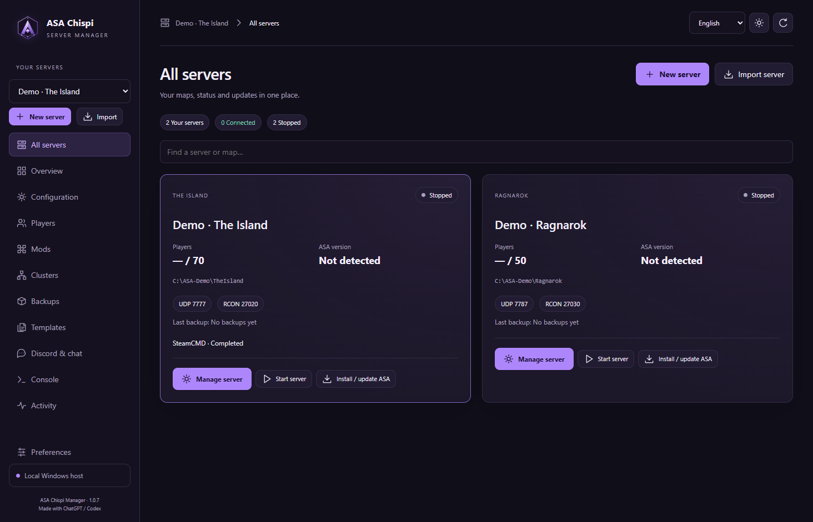
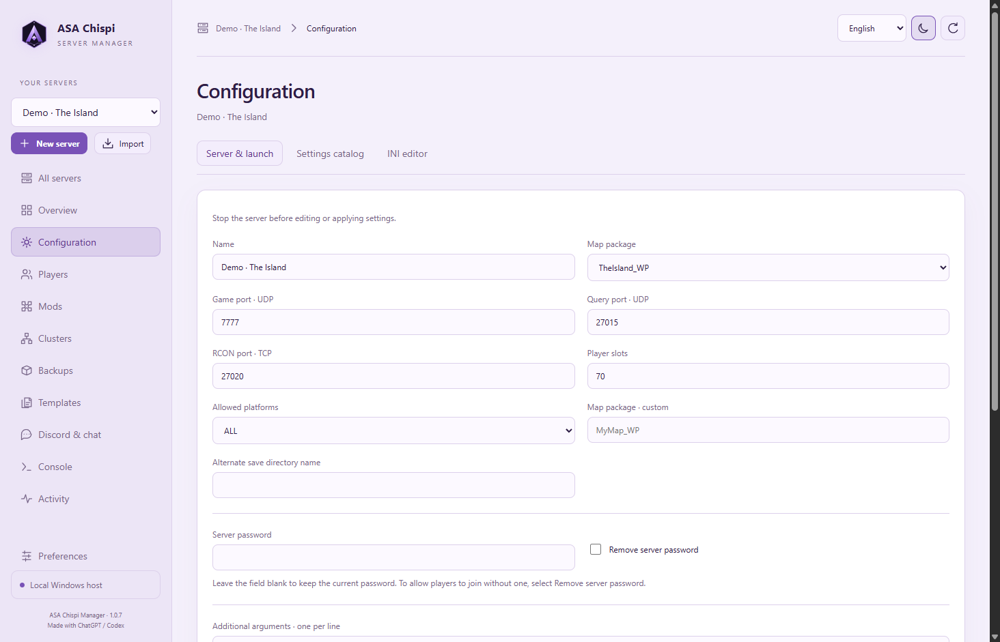
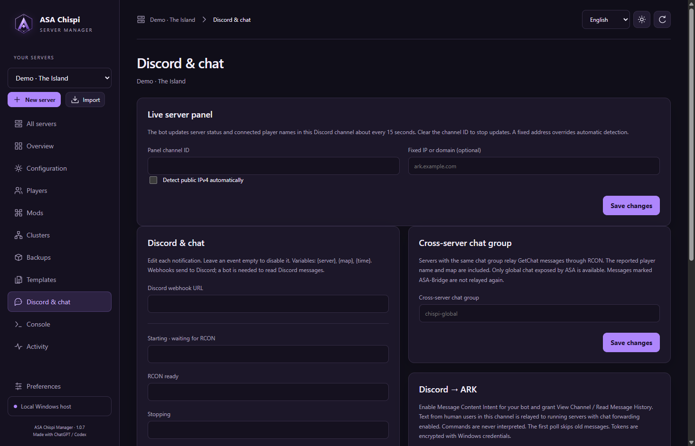
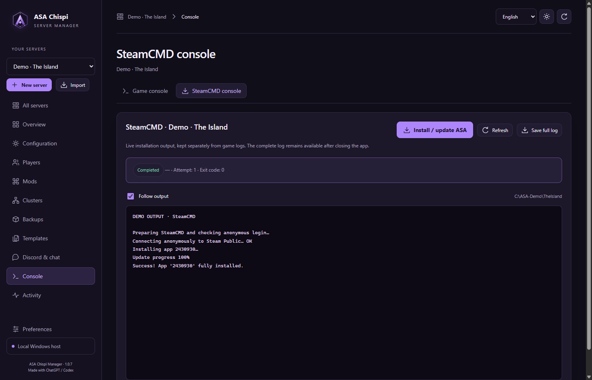

# ASA Chispi Manager

> [!IMPORTANT]
> **Developed with artificial intelligence.** ChatGPT and Codex were used extensively to write the code, design the interface, create automated tests and write the documentation for Chispinela.

A Windows desktop manager for **ARK: Survival Ascended** dedicated servers. Install and update several maps, manage saves and clusters, and publish a live server dashboard in Discord. Independent community project.

**[Download the Windows x64 installer · v1.0.7](https://github.com/Chispinela/asa-chispi-manager/releases/download/v1.0.7/ASA-Chispi-Manager-Setup-1.0.7.exe)** · [Release notes and checksum](https://github.com/Chispinela/asa-chispi-manager/releases/tag/v1.0.7) · **[Guía completa en castellano](docs/GUIA.md)**

The interface is available in English, Castellano, Português, Русский, 简体中文 and 日本語, with light and dark violet themes.

## Install and create your first server

1. Run the installer on a 64-bit Windows 10 or 11 machine. Select a language and open ASA Chispi Manager. You do not need to install Node.js or Python to use the packaged app.
2. Open **Preferences → Repair / download SteamCMD**, or browse to an existing SteamCMD executable. Leave enough free disk space for the game files, world saves, updates and backups.
3. Select **New server**, choose an empty folder such as `D:\ASA\TheIsland`, and give it a name. Select `TheIsland_WP` for The Island. Keep game port **7777**, query port **27015** and RCON **27020** if they are available. Use a separate folder and distinct ports for each additional server.
4. Choose an optional **Server password** for players. Leave it blank for open entry. Set an **Administrator password** for ARK admin and RCON, or leave that field blank to generate one.
5. Click **Install / update ASA**. The SteamCMD console shows progress and errors for Steam app `2430930`. Wait for success, then choose **Start server** and wait for RCON to respond.
6. Join from the unofficial server list in ARK or connect using the host address and game port. For Internet access, configure the game port in Windows and your router as required by your network. Keep RCON on the host. The manager connects to it via loopback.

To change entry access later, stop the server and open **Configuration → Server & launch**. Type a new password, leave the field blank to keep the existing one, or choose **Remove server password**. Save and start the server again.

## Common tasks

| Task | Where to do it |
| --- | --- |
| Import an existing installation | **Import server** → choose the folder containing `ShooterGame` → inspect and review the settings. Stop HaruHost first and follow the [migration guide](docs/MIGRACION.md). |
| Edit game settings | **Configuration** → searchable settings catalog or full editor for `Game.ini`, `GameUserSettings.ini` and `Engine.ini`. The catalog is a curated reference and compatibility can vary with the ASA version. |
| Add mods | **Mods** → enter numeric CurseForge project IDs in the desired load order → save and start. |
| Link maps | **Clusters** → choose an ID and shared transfer folder → select stopped servers → review upload/download settings → start the maps. |
| Manage players | **Players** → see current RCON roster and recorded history, review tribe data, manage the EOS admin whitelist, or copy in-game teleport commands. |
| Send a server command | **Console → Game console** → enter a command such as `Broadcast Server restart in 10 minutes`. |
| Schedule backups | **Backups** → select weekdays and one or more local times, such as `06:00, 18:00`. A backup can stop and restart running members of the selected server's cluster. |
| Reuse a configuration | **Templates** → save, export or import an INI and mod preset. The target keeps its managed identity, ports and passwords. |
| Diagnose an update | **Console → SteamCMD console** → inspect the exit code and export the full log. See the [SteamCMD troubleshooting guide](docs/REPARACION-STEAMCMD.md). |

## Discord and shared chat

- **Lifecycle notices.** In **Discord & chat**, enter a webhook for the selected server. Customize the event text using `{server}`, `{map}` and `{time}`. Leave an event blank to skip it.
- **Game chat.** Enable chat forwarding per server. A webhook can post game chat to Discord. For Discord-to-game relay, configure a bot token and channel ID, enable Message Content Intent in the Discord Developer Portal, and grant the bot View Channel and Read Message History. Grant Send Messages for bot-based game-to-Discord posting. Check the bot connection from the manager.
- **Live server panel.** Enter a separate channel ID in **Live server panel**. Choose automatic public IPv4 detection or a fixed address. The bot needs View Channel, Send Messages, Embed Links and Attach Files. It updates its own cards with map, version, connection address, status and connected players. Use a channel whose audience may see that data.
- **Chat across maps.** Give the participating servers the same chat group. Messages show the available character or player name and the source map.

Keep the manager open for scheduled backups, Discord and shared chat. Bot and webhook credentials are encrypted for the current Windows user. ARK INI files and backups can contain plaintext passwords, so review them before sharing. See [Discord's bot settings](https://docs.discord.com/developers/events/gateway#message-content-intent) and [channel permissions](https://docs.discord.com/developers/topics/permissions).

## Screenshots

The gallery shows the current interface using fictional server profiles.

| Server list | Server and launch settings |
| --- | --- |
|  |  |
| **Discord configuration** | **SteamCMD console** |
|  |  |

## Build from source

Use Windows x64, Node.js 22 or later and PowerShell. The reader preparation script downloads hash-verified versions of embedded Python and arkparser. The installer bundles the reader and its licenses.

~~~powershell
git clone https://github.com/Chispinela/asa-chispi-manager.git
cd asa-chispi-manager
npm ci
powershell -NoProfile -ExecutionPolicy Bypass -File scripts/prepare-reader.ps1
npm test
npm run test:ui
npm run dist
~~~

The installer is written to `release/`. For development, run `npm start`. Set `ASA_MANAGER_DATA` to a separate folder for an isolated instance. If npm did not run Electron's install script, run `node node_modules/electron/install.js` before the UI tests.

See [validation and scope](docs/VALIDACION.md), [ARK server configuration](https://ark.wiki.gg/wiki/Server_configuration) and [Valve SteamCMD](https://developer.valvesoftware.com/wiki/SteamCMD).

Released under the [MIT license](LICENSE). ARK: Survival Ascended and related trademarks belong to their respective owners.

